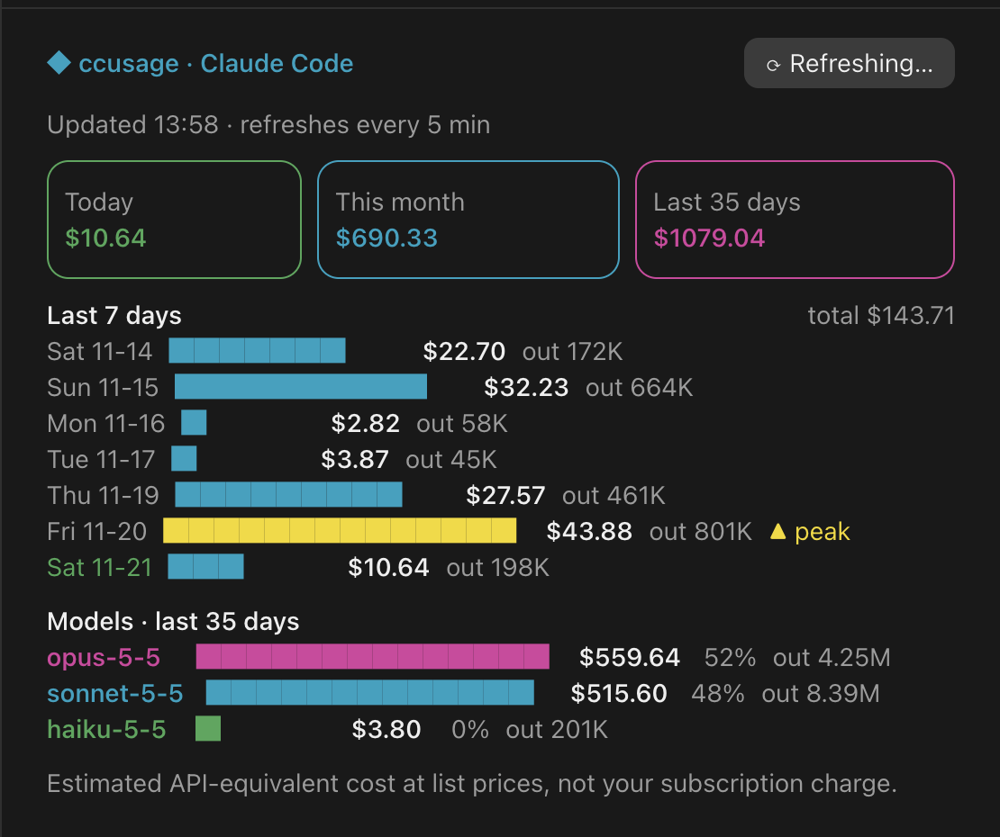

# ccusage-pane

A Claude Code / Claude Desktop pane that shows your Claude Code usage and
**estimated** cost, powered by [ccusage](https://github.com/ryoppippi/ccusage).



It shows today's cost, this month's cost, the last 35 days, the last 7 days
(cost and output tokens) and a per-model breakdown. It refreshes every 5
minutes and has a Refresh button.

- Runs `ccusage claude daily --json -b` locally. Nothing is uploaded.
- Uses `ccusage` from your PATH if installed, otherwise `npx ccusage@latest`
  (needs Node.js). The first run reads all your logs and can take a while.
- Costs are API-list-price estimates, **not** what a Claude subscription charges.
- It only measures usage; it does not reduce it.

## Install

At the prompt of a terminal session:

```
/plugin install ccusage-pane --marketplace miladghorbani1999/ccusage-pane
```

From a shell:

```
claude plugin install ccusage-pane --marketplace miladghorbani1999/ccusage-pane
```

In the desktop app, where `/plugin` does not run: click + next to the prompt
box, then Plugins, Add marketplace with `miladghorbani1999/ccusage-pane`, then
Add plugin.

## Use

Type `/ccusage` in the chat to open the pane.

## License

MIT
